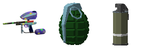

# GetGavD Mods

Scrap Mechanic mods — **made by GetGavd**.

## Mods & downloads

| Mod | What it does | Download |
| --- | --- | --- |
| **[ColourForge](Docs/ColourForge.md)** | Custom paint gun, full colour wheel, RGB/HEX controls, drag painting, erase and eyedropper | **[Complete installer ZIP](https://github.com/Gavthestig/GetGavD/releases/download/colourforge-v1.1/ColourForge-1.1-Share.zip)** · [Release notes](https://github.com/Gavthestig/GetGavD/releases/tag/colourforge-v1.1) |
| **[Paintball & Grenades](Docs/Paintball.md)** | Coloured paintballs, temporary splats, paint grenades and coloured smoke | **[Testing ZIP](https://github.com/Gavthestig/GetGavD/releases/download/paintball-v0.8-test/ColourForge-Paintball-and-Grenades-test.zip)** · [Release notes](https://github.com/Gavthestig/GetGavD/releases/tag/paintball-v0.8-test) |

## ColourForge

Pick a colour and paint with your own gun. Changes apply live; no “Ready to paint” confirmation is needed. Gun accents follow your selected colour.

*Layout preview rendered from the current GUI files; the in-game appearance can differ.*

## How to download and enable

There are 2 ways to install or update the ColourForge module:

Complete installer / SM-DLL-Injector (recommended)

1. Close Scrap Mechanic.
2. Download [ColourForge-1.1-Share.zip](https://github.com/Gavthestig/GetGavD/releases/download/colourforge-v1.1/ColourForge-1.1-Share.zip) and extract the complete ZIP to a folder.
3. Run **Install.cmd**. Setup finds your Steam installation or asks for the game folder.
4. Start Scrap Mechanic normally and find **ColourForge** in Tools.

The installer registers the gun, GUI and icons, installs **ColourForge.dll** into `Scrap Mechanic/Release/DLLModules`, and obtains the official [SM-DLL-Injector v1.8](https://github.com/QuestionableM/SM-DLL-Injector/releases/tag/v1.8) if needed. Internet access is required for that download. Players do not need Visual Studio or Python.

Keep the backup folder. Run **Uninstall.cmd** before updating the game or changing other modifications to the same files.

Manual DLL update (existing complete installations)

Use this option only if you already installed the complete ColourForge companion setup. A DLL alone does not include the gun, GUI, icons or Challenge registration.

1. Close Scrap Mechanic.
2. Download [ColourForge.dll](https://github.com/Gavthestig/GetGavD/releases/download/colourforge-v1.1/ColourForge.dll) or [ColourForge-DLL.zip](https://github.com/Gavthestig/GetGavD/releases/download/colourforge-v1.1/ColourForge-DLL.zip).
3. Replace **ColourForge.dll** in `Scrap Mechanic/Release/DLLModules`.
4. If the older **Native-Drag-Bridge.dll** is present, move it out of `DLLModules` and keep a backup. Do not load both modules together.
5. Start the game normally. Your existing SM-DLL-Injector installation loads the module.

If the gun, GUI or icon is missing, use the complete installer instead. The old **SM-BetterPaintTool.dll** is not a ColourForge dependency.

**Workshop subscription alone is not a complete installation.** ColourForge needs its native painting component and game registration from the companion installer. [Workshop page](https://steamcommunity.com/sharedfiles/filedetails/?id=3834631547) · [Detailed setup and troubleshooting](Docs/ColourForge.md).

### Controls

| Input | ColourForge | Paintball gun |
| --- | --- | --- |
| Left mouse | Drag paint | Shoot |
| Right mouse | Drag erase | Aim / zoom |
| Q | Colour picker | Colour picker |
| Escape | Close picker | Close picker |
| Middle mouse | Sample a shape’s colour | — |
| R | — | Reload |

### Compatibility & testing

| Component | Status |
| --- | --- |
| Windows x64, game 1.0.6.889 | Earlier ColourForge build user-tested in Creative and Challenge Builder |
| Windows x64, game 1.0.7a.903 | Native code rebuilt and installer checks passed; actual painting on this build still needs testing |
| Survival / Challenge play | Installer registration included; not fully tested. Challenge play requires the paint tool to be allowed |
| Other game versions | Unsupported; native component refuses unknown executable fingerprints |
| Multiplayer | Unverified |

## Paintball & Grenades — testing build

 

Paintballs leave temporary marks on hit surfaces and characters. Includes a colour picker, hopper refill visuals, aiming, paint grenades and smoke grenades. This is a prototype: the latest smoke colour/coverage changes still need in-game verification. Smoke is visual and does not change bot targeting. Dedicated grenade sounds have not been added.

Use the testing ZIP for **Creative local-mod testing**. The separately prepared local Challenge integration is **not a portable installer in this ZIP**. Survival and multiplayer support are unverified. [Installation and limitations](Docs/Paintball.md).

