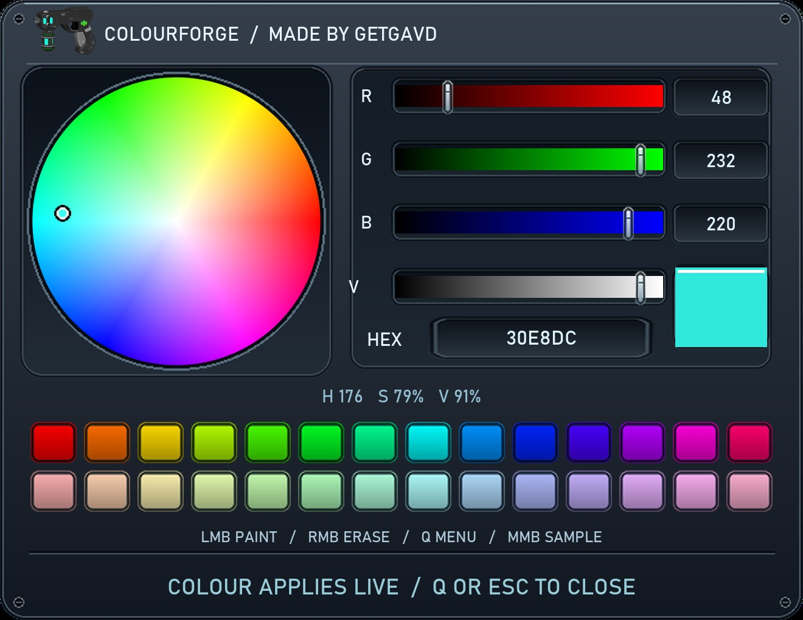
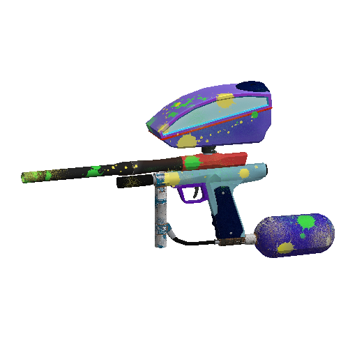

# GetGavD Mods

Scrap Mechanic mods — **made by GetGavd**.

## Mods & downloads

| Mod | What it does | Download |
| --- | --- | --- |
| **[ColourForge](Docs/ColourForge.md)** | Custom paint gun, full colour wheel, RGB/HEX controls, drag painting, erase and eyedropper | **[Complete installer ZIP](https://github.com/Gavthestig/GetGavD/releases/download/colourforge-v1.1/ColourForge-1.1-Share.zip)** · [Release notes](https://github.com/Gavthestig/GetGavD/releases/tag/colourforge-v1.1) |
| **[Paintball & Grenades](Docs/Paintball.md)** | Coloured paintballs, temporary splats, paint grenades and coloured smoke | **[Testing ZIP](https://github.com/Gavthestig/GetGavD/releases/download/paintball-v0.8-test/ColourForge-Paintball-and-Grenades-test.zip)** · [Release notes](https://github.com/Gavthestig/GetGavD/releases/tag/paintball-v0.8-test) |

## ColourForge

Pick a colour and paint with your own gun. Changes apply live; no “Ready to paint” confirmation is needed. Gun accents follow your selected colour.

*Layout preview rendered from the current GUI files; the in-game appearance can differ.*

### Installation

1. Close Scrap Mechanic. Download and extract the **complete installer ZIP** above.
2. Run **Install.cmd**. Setup finds your Steam installation or asks for the game folder.
3. Start the game normally and find **ColourForge** in Tools.

Players do not need Visual Studio or Python. Setup requires internet access to download QuestionableM’s official DLL loader if missing. Keep the backup folder and use **Uninstall.cmd** before updating the game or changing other modifications to the same files.

**Workshop subscription alone is not a complete installation.** ColourForge needs its native painting component and game registration from the companion installer. [Workshop page](https://steamcommunity.com/sharedfiles/filedetails/?id=3834631547) · [Detailed setup and troubleshooting](Docs/ColourForge.md).

### Controls

| Input | ColourForge | Paintball gun |
| --- | --- | --- |
| Left mouse | Drag paint | Shoot |
| Right mouse | Drag erase | Aim / zoom |
| Q | Colour picker | Colour picker |
| Escape | Close picker | Close picker |
| Middle mouse | Sample a shape’s colour | — |
| R | — | Reload |

### Compatibility & testing

| Component | Status |
| --- | --- |
| Windows x64, game 1.0.6.889 | Earlier ColourForge build user-tested in Creative and Challenge Builder |
| Windows x64, game 1.0.7a.903 | Native code rebuilt and installer checks passed; actual painting on this build still needs testing |
| Survival / Challenge play | Installer registration included; not fully tested. Challenge play requires the paint tool to be allowed |
| Other game versions | Unsupported; native component refuses unknown executable fingerprints |
| Multiplayer | Unverified |

## Paintball & Grenades — testing build

 

Paintballs leave temporary marks on hit surfaces and characters. Includes a colour picker, hopper refill visuals, aiming, paint grenades and smoke grenades. This is a prototype: the latest smoke colour/coverage changes still need in-game verification. Smoke is visual and does not change bot targeting. Dedicated grenade sounds have not been added.

Use the testing ZIP for **Creative local-mod testing**. The separately prepared local Challenge integration is **not a portable installer in this ZIP**. Survival and multiplayer support are unverified. [Installation and limitations](Docs/Paintball.md).

## Source, issues & credits

* [Native ColourForge source](Code/) · [Editable mod scripts](Mods/) · [Installer scripts](Installer/) · [Check results](Tests/) · [Changelog](CHANGELOG.md)
* [Report a problem](https://github.com/Gavthestig/GetGavD/issues/new/choose): include the exact game version, mode, mod version and steps to reproduce.
* [Third-party models and licences](THIRD-PARTY-NOTICES.md).

Repository presentation inspired by [QuestionableM’s BetterPaintTool](https://github.com/QuestionableM/SM-BetterPaintTool). ColourForge uses its own native module; the old BetterPaintTool DLL is not a replacement for ColourForge.dll. Independent community mods, not an official Axolot product.
