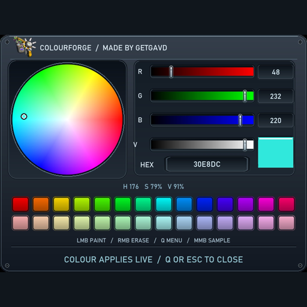

# GetGavD Mods

Scrap Mechanic mods — **made by GetGavd**.

[](https://github.com/Gavthestig/GetGavD/releases/tag/colourforge-v1.1)


<p align="center"></p>

## Mods & downloads

| Mod | What it does | Download |
| --- | --- | --- |
| **[ColourForge](Docs/ColourForge.md)** | Custom paint gun, full colour wheel, RGB/HEX controls, drag painting, erase and eyedropper | **[Complete installer ZIP](https://github.com/Gavthestig/GetGavD/releases/download/colourforge-v1.1/ColourForge-1.1-Share.zip)** · [Release notes](https://github.com/Gavthestig/GetGavD/releases/tag/colourforge-v1.1) |
| **[Paintball & Grenades](Docs/Paintball.md)** | Coloured paintballs, temporary splats, paint grenades and coloured smoke | **[Testing ZIP](https://github.com/Gavthestig/GetGavD/releases/download/paintball-v0.8-test/ColourForge-Paintball-and-Grenades-test.zip)** · [Release notes](https://github.com/Gavthestig/GetGavD/releases/tag/paintball-v0.8-test) |

## ColourForge

Pick a colour and paint with your own gun. Changes apply live; no “Ready to paint” confirmation is needed. Gun accents follow your selected colour.


*Layout preview rendered from the current GUI files; the in-game appearance can differ.*

## How to download and enable

**Icon fix available:** if your inventory icons became mixed up after installing ColourForge, [download the corrected complete installer](https://github.com/Gavthestig/GetGavD/releases/download/colourforge-v1.1/ColourForge-1.1-Share.zip) again. Close the game, extract the ZIP and run **Install.cmd**. This update fixes the installer; replacing the DLL alone does not repair the icon sheet. [Fix details](CHANGELOG.md).

**New here? Follow steps 1–6 below for the Workshop version in Creative mode.** You need three things: the Workshop mod, ColourForge.dll, and the injector that loads the DLL. You do not need Visual Studio or any coding knowledge.

### 1. Download the mod from Steam Workshop

Open [ColourForge on Steam Workshop](https://steamcommunity.com/sharedfiles/filedetails/?id=3834631547) and click the green **Subscribe** button. Wait for Steam to finish downloading it.

**Subscribe downloads the gun, textures, colour menu and scripts. It does not install the DLL or injector.**

### 2. Close Scrap Mechanic

Quit the game completely before installing the next two files.

### 3. Download and install the injector

Click **[Download DLL-Injector-Installer.exe](https://github.com/QuestionableM/SM-DLL-Injector/releases/download/v1.8/DLL-Injector-Installer.exe)** from QuestionableM's official release.

Open your **Downloads** folder, double-click **DLL-Injector-Installer.exe**, and follow its prompts. The injector makes Scrap Mechanic load ColourForge.dll when the game starts.

[Injector release page](https://github.com/QuestionableM/SM-DLL-Injector/releases/tag/v1.8) · [Author's installation instructions](https://github.com/QuestionableM/SM-DLL-Injector#how-to-install)

### 4. Download ColourForge.dll

Click **[Download ColourForge.dll](https://github.com/Gavthestig/GetGavD/releases/download/colourforge-v1.1/ColourForge.dll)**. Leave it in your Downloads folder for the next step. **Do not double-click the DLL** — it is a file to put in the game folder, not a program to open.

### 5. Put the DLL in the game folder

1. Open **Steam → Library**.
2. Right-click **Scrap Mechanic** and choose **Properties**.
3. Click **Installed Files → Browse**. This opens the correct game folder, even if your game is installed on another drive.
4. Open the folder called **Release**.
5. Open **DLLModules**. If it does not exist, right-click an empty space, choose **New → Folder**, and name it **DLLModules**.
6. Copy **ColourForge.dll** from Downloads into that **DLLModules** folder.

Your file should be here:

```text
Scrap Mechanic
└── Release
    └── DLLModules
        └── ColourForge.dll
```

If you used an older ColourForge test build, move **Native-Drag-Bridge.dll** out of DLLModules and keep it elsewhere as a backup. Do not leave both bridge DLLs installed. **SM-BetterPaintTool.dll is not needed for ColourForge.**

### 6. Enable the mod and play

Start Scrap Mechanic. In your Creative world's mod selection, enable **ColourForge**, then load the world. Open your backpack, look under **Tools**, and put ColourForge on your hotbar. Select the gun and press **Q** to open the colour picker.

**Left mouse:** paint · **Right mouse:** erase · **Middle mouse:** copy a shape's colour · **Q / Escape:** close the picker.

### Want Challenge mode or an easier automatic setup?

Use the complete installer below instead of the Workshop steps above. It installs the mod files, DLL and injector together, plus the extra Challenge registration. You do not need to install the same files twice.

<details>
<summary>Automatic setup — click here for the steps</summary>

1. Close Scrap Mechanic.
2. Click **[Download ColourForge-1.1-Share.zip](https://github.com/Gavthestig/GetGavD/releases/download/colourforge-v1.1/ColourForge-1.1-Share.zip)**.
3. In Downloads, right-click the ZIP and choose **Extract All**, then **Extract**.
4. Open the extracted folder and double-click **Install.cmd**. Do not run it from inside the ZIP.
5. Follow the prompts. Setup finds your Steam game folder or asks you to select it. Internet access is needed to obtain the injector if missing.
6. Start the game normally and look for **ColourForge** in Tools.

Keep the backup folder. To remove this setup, close the game and run **Uninstall.cmd**. Uninstall before updating the game or changing other modifications to the same files.

</details>

**Before downloading:** Windows x64, game **1.0.6.889** or **1.0.7a.903** only. Painting on 1.0.7a, multiplayer and Survival/Challenge-play wiring still need verification. The Workshop route also needs separate-installation verification. Challenge play must allow the paint tool; Workshop + DLL alone does not add Challenge registration.

<details>
<summary>Manual DLL update (existing complete installations)</summary>

Use this option only if you already installed the complete ColourForge companion setup. A DLL alone does not include the gun, GUI, icons or Challenge registration.

1. Close Scrap Mechanic.
2. Download [ColourForge.dll](https://github.com/Gavthestig/GetGavD/releases/download/colourforge-v1.1/ColourForge.dll) or [ColourForge-DLL.zip](https://github.com/Gavthestig/GetGavD/releases/download/colourforge-v1.1/ColourForge-DLL.zip).
3. Replace **ColourForge.dll** in `Scrap Mechanic/Release/DLLModules`.
4. If the older **Native-Drag-Bridge.dll** is present, move it out of `DLLModules` and keep a backup. Do not load both modules together.
5. Start the game normally. Your existing SM-DLL-Injector installation loads the module.

If the gun, GUI or icon is missing, use the complete installer instead. The old **SM-BetterPaintTool.dll** is not a ColourForge dependency.

</details>

**Need help?** [Open the setup and troubleshooting guide](Docs/ColourForge.md).

### Controls

| Input | ColourForge | Paintball gun |
| --- | --- | --- |
| Left mouse | Drag paint | Shoot |
| Right mouse | Drag erase | Aim / zoom |
| Q | Colour picker | Colour picker |
| Escape | Close picker | Close picker |
| Middle mouse | Sample a shape’s colour | — |
| R | — | Reload |

### Compatibility & testing

| Component | Status |
| --- | --- |
| Windows x64, game 1.0.6.889 | Earlier ColourForge build user-tested in Creative and Challenge Builder |
| Windows x64, game 1.0.7a.903 | Native code rebuilt and installer checks passed; actual painting on this build still needs testing |
| Survival / Challenge play | Installer registration included; not fully tested. Challenge play requires the paint tool to be allowed |
| Other game versions | Unsupported; native component refuses unknown executable fingerprints |
| Multiplayer | Unverified |

## Paintball & Grenades — testing build

<p> </p>

Paintballs leave temporary marks on hit surfaces and characters. Includes a colour picker, hopper refill visuals, aiming, paint grenades and smoke grenades. This is a prototype: the latest smoke colour/coverage changes still need in-game verification. Smoke is visual and does not change bot targeting. Dedicated grenade sounds have not been added.

Use the testing ZIP for **Creative local-mod testing**. The separately prepared local Challenge integration is **not a portable installer in this ZIP**. Survival and multiplayer support are unverified. [Installation and limitations](Docs/Paintball.md).
